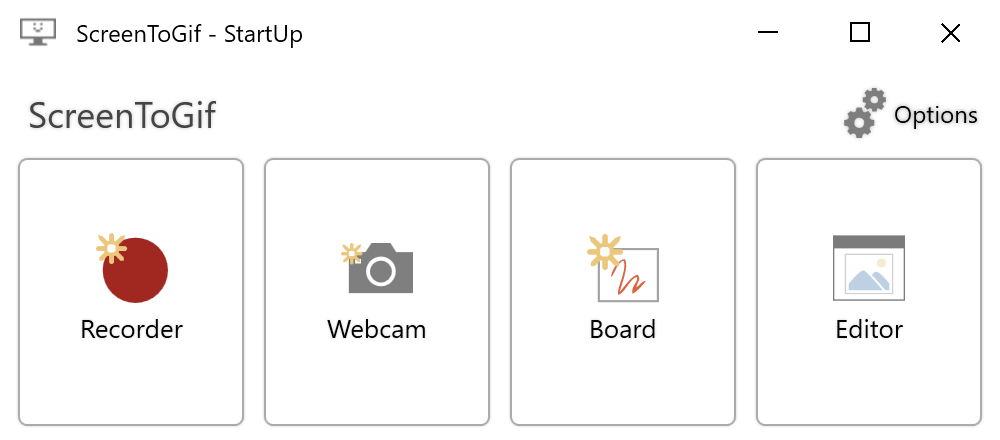
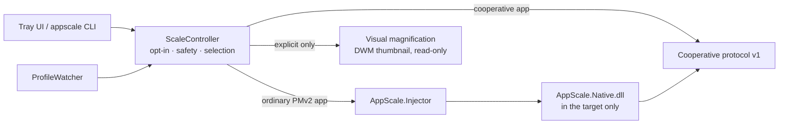

# AppScale

**Scale one app, not your whole monitor.** Pick an application, choose 75–250 %, and AppScale makes *that app*
rerender natively at that DPI. Your display settings and every other app stay as they are.

> **Experimental proof of concept.** It shows a feature Windows *should* have: a per-app, user-consented DPI
> override. It does this today by lying to the app, inside that one process, about what DPI it is running at.
> See the [platform proposal](docs/platform-proposal.md) for what an OS-owned version would need.

| ScreenToGif at the monitor's 150 % | The same unmodified app, told it's at 200 % |
|---|---|
|  |  |

The text is crisp because the app *redraws* itself at 192 DPI. The image is not stretched. The same works for
VS Code (Electron), WinForms and WPF apps, and Win32 client areas.
See the [compatibility matrix](docs/compatibility.md).

## How it works

1. **You pick an app** in the tray UI or with `appscale apply <pid> 200`, or save a profile with **Remember**.
2. AppScale loads `AppScale.Native.dll` into **that one process**. If the app caches its DPI at startup, it does this
   when the app launches; otherwise it does it while the app is running.
3. The DLL uses [Microsoft Detours](https://github.com/microsoft/Detours) to change what the app sees from
   `GetDpiForWindow`, `GetDpiForSystem`, `GetDpiForMonitor`, `GetDeviceCaps(LOGPIXELS)` and the DPI-dependent system
   metrics. They report the DPI you asked for.
4. The DLL then sends the app the same `WM_DPICHANGED` message Windows sends when a window moves to another monitor.
   The app relays itself out using code it already has.
5. **The background watcher** reapplies your saved profiles whenever those apps start.
6. **Reset** sends the real DPI back. Nothing persists: the DLL leaves when the app exits.



Some apps can't be rerendered: **system-aware and DPI-unaware apps** (Windows bitmap-scales them) and any app whose
framework ignores the lie. For these, AppScale reports that it can't, and offers a clearly labelled, read-only
**visual magnification** window instead. It never silently switches to bitmap scaling.

## What it won't do

- **No display changes.** It never changes global display settings.
- **No admin or system-wide access.** It needs no elevation and uses no global hooks or system-wide injection.
- **Nothing collected or left behind.** No telemetry, and nothing persists inside target apps.
- **Off by default.** Nothing happens until you opt in and pick the app. Saved profiles are disabled until you enable
  them.
- **Some apps are always refused:** elevated, protected, AppContainer, 32-bit, shell, security and credential apps,
  and anything under `%WINDIR%`.
- **Emergency disable** (in the tray or `appscale emergency-disable`) resets everything and blocks further applies.
- **Not an accessibility solution (yet).** Hit-testing, IME, touch and UI Automation after injection haven't been
  validated. See the [test report](docs/test-report.md).

## Build

Requirements: Windows 11 x64, Visual Studio 2022 or later with C++ (MSVC), CMake ≥ 3.24, and the .NET 10 SDK.

```powershell
scripts\build.ps1                # native (CMake + Detours via FetchContent) + managed + unit tests
scripts\build.ps1 -Integration   # also launches the harnesses and tests injection end to end (needs a desktop)
```

Outputs go to `artifacts\bin\<Project>\release\`:
- `AppScale.UI.exe` (the tray app)
- `appscale.exe` (the CLI)
- `AppScale.Injector.exe` and `AppScale.Native.dll` (in `artifacts\bin\Win32Harness\release\`)

## CLI

```text
appscale list                      windows with DPI, awareness, and exclusion status
appscale monitors                  each monitor's real DPI
appscale dpi 150                   absolute DPI (144) and relative zoom on each monitor
appscale optin
appscale inspect <pid|0xHWND>      what each backend thinks of this window
appscale apply <pid|0xHWND> 200    rescale now (inject or cooperative)
appscale reset <pid|0xHWND>
appscale launch <exe> 200 --inject start an app with hooks in place (for apps that cache DPI)
appscale profiles save <exe> 175 && appscale profiles enable <exe>
appscale watch                     auto-apply enabled profiles as apps start
appscale emergency-disable
```

The scale is **absolute**: 150 % means 144 DPI on every monitor. **Relative zoom** (requested DPI ÷ the monitor's DPI)
is shown separately and is only used for visual magnification.

## Repository layout

| Path | What |
|---|---|
| `src/AppScale.Core` | `IScaleBackend`, backends (cooperative, inject, visual), safety, selector, profiles, watcher |
| `src/AppScale.UI` | WPF tray controller: picker, preview, apply/remember/launch, emergency disable |
| `src/AppScale.Cli` | `appscale.exe` diagnostic CLI |
| `src/AppScale.Native` | Detours DPI adapter DLL and the injector (C++) |
| `tests/Win32Harness`, `tests/WinFormsHarness`, `tests/WpfHarness` | Owned test apps (cooperative and `--no-cooperative` stock modes) |
| `tests/AppScale.Core.Tests`, `tests/AppScale.IntegrationTests` | xUnit unit and end-to-end tests |
| `docs/` | [spec](docs/specification.md), [ADRs](docs/adr), [compatibility](docs/compatibility.md), [test report](docs/test-report.md), [checklist](docs/manual-test-checklist.md), [evidence](docs/evidence), [platform proposal](docs/platform-proposal.md) |

## What we learned

The lie works well for frameworks that draw their own UI: WPF, Electron, and WinForms/Win32 client areas. Their DPI
handling is already correct. They just need to be told a different number. It can't fix what **Windows itself draws**:
classic caption bars, menu bars, scroll bars, common-control tooltips and system-aware apps. That boundary is
exactly why this should be an OS feature. See the [platform proposal](docs/platform-proposal.md) and
[ADR 0004](docs/adr/0004-injection-decision-gate.md).

## License

MIT
